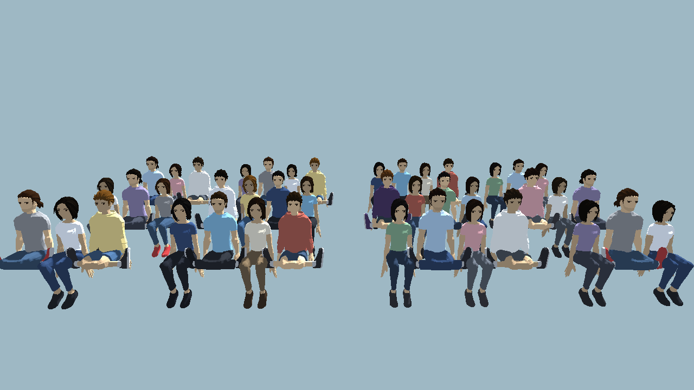
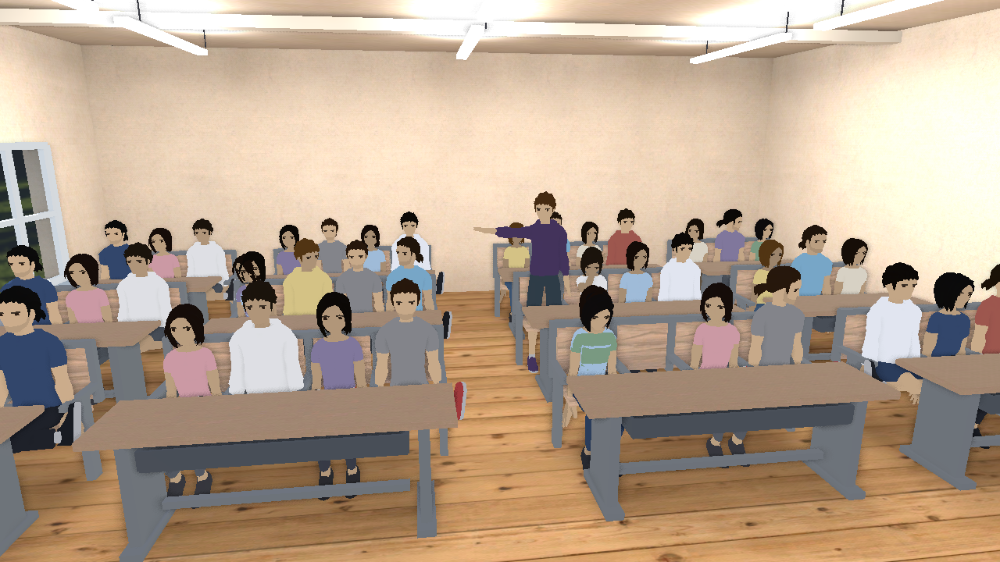
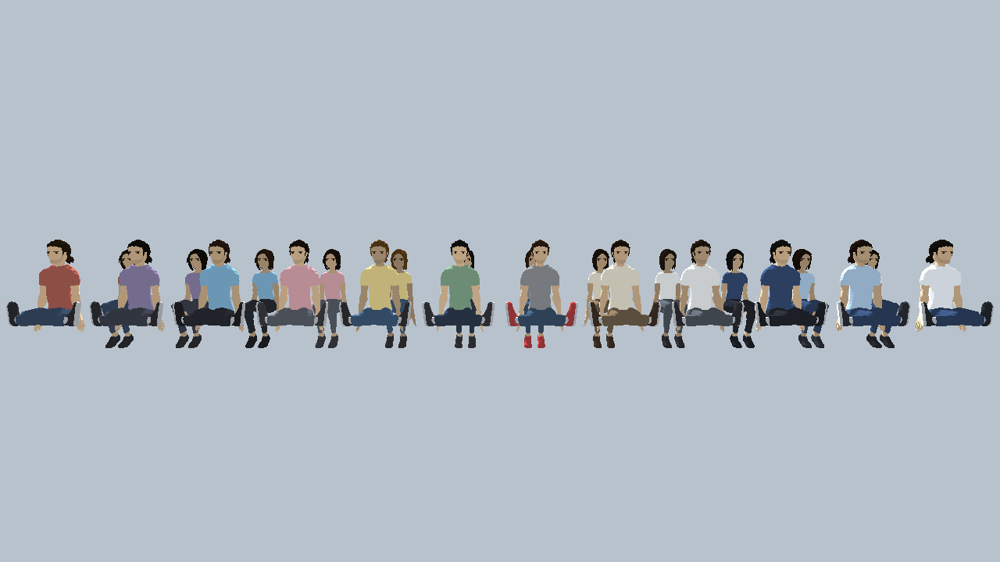
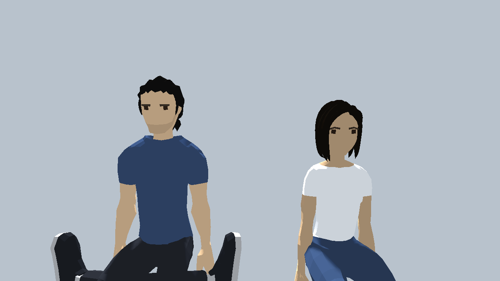

# 任务四：教室学生便装替换交付记录（2026-10-23）

- 负责人：@Yai1024（D 人物）
- 任务来源：用户反馈「教室里的学生不全是学生装扮，替换掉装扮不合适的人物模型，同时保证场景不过于单调」
- 状态：**已完成**（人物侧交付；台词/流程接入不变）

## 问题

上一版满座教室的 11 款同学里，只有 Casual2、WomensCasual 算学生便装，其余 9 款是
工装、户外、泳装、背带草帽、朋克等造型：

| 旧造型 | 问题 |
| --- | --- |
| Worker / WomensWorker | 橙色反光背心 + 黄色安全帽 |
| Farmer | 草帽 + 背带工装 |
| Beach | 白背心 + 白帽 + 泳裤 |
| Adventurer / WomensAdventurer | 户外夹克 + 背包 + 登山靴 |
| Punk / WomensPunk | 莫西干发型 + 铆钉皮衣 |
| WomensFormal | 正装连衣裙 |

这些模型放进中学教室会直接破坏场景可信度。

## 方案：3 款便装 × 12 套配色 × 身高微调

Quaternius 的 Modular Men / Women 包里没有更多「学生制服」，但模型是**纯色材质 + 按部位拆网格**
（Body / Legs / Feet / Head），可以直接在运行时改色，不必改 .glb：

- 基础模型只用 3 款学生便装：`Casual2`（男·短袖长裤）、`Casual`（男·卫衣短裤）、`WomensCasual`（女·短袖长裤）。
- `scripts/character_pose.gd` 新增 `OUTFIT_PALETTES`：12 套配色，覆盖上衣 / 裤子 / 鞋 / 头发，
  肤色按 `skin_tone` 系数微调。每件实例复制自己的材质，互不影响，不改源文件。
- 新增导出属性：
  - `outfit`（0–12，0 = 原色；主角与教师保持 0）
  - `height_scale`（0.97–1.03，坐姿不影响座面高度）
- 满座 42 人按「同排左右、同列前后、隔排同列」都不撞色/不撞模型的原则排布；
  配色与基础模型的使用次数拉平（每套配色 3–5 人，男女各 21 人）。

效果：全员学生便装，同时靠颜色、发色、肤色、身高和 3 种轮廓（短袖 / 卫衣 / 女款）区分个体，
不会像克隆人。

## 效果图

满座教室（42 人全员便装，前后左右不撞色）：

课堂对话场景（真实教室内 33 名同学 + 主角站讲）：

12 套配色对照（上排男、下排女）：

近景检查（发色覆盖不影响眉毛与眼睛）：

## 场景与文件变更

| 文件 | 变更 |
| --- | --- |
| `scripts/character_pose.gd` | 新增 `OUTFIT_PALETTES`、`outfit`、`height_scale` 与运行时改色逻辑（按 Body/Legs/Feet/Head 部位判断角色；头发取头部顶点数最多的非五官材质，避免误改眉毛） |
| `scenes/actors/character_pose/classroom_seating.tscn` | 重新生成：42 座，3 款便装 + 12 套配色；主角仍在第二排第七位 `(-0.7, 0, 1.78)` |
| `scenes/actors/character_pose/classroom_dialogue_preview.tscn` | 重新生成：33 名同学 + 教师 + 主角站讲 + E02/E03 + 6 人议论，站位与节点名全部保持原样 |
| `scenes/actors/character_pose/preview.tscn` | 后排 6 名同学改为便装配色 |
| `event_cover_mouth / event_side_glance / event_nod` | 补 `outfit` 配色；E03 点头从 Farmer 换成 WomensCasual |
| 新增 `classmate_casual_{sit,down,whisper_l,whisper_r}.tscn`、`classmate_casual2_whisper_l/r.tscn`、`classmate_womenscasual_whisper_r.tscn` | 3 款便装补齐坐姿 / 低头 / 交头接耳全套 |
| 删除 23 个旧装扮场景包装（`classmate_worker_*`、`classmate_farmer_*`、`classmate_beach_*`、`classmate_punk_*`、`classmate_adventurer_*`、`classmate_womensformal_*`、`classmate_womensworker_*`、`classmate_womensadventurer_*`、`classmate_womenspunk_*`） | 不再出现在任何场景；对应 .glb 保留在 `assets/characters/quaternius/` 作其他场景备用（README 已标注） |

主角（紫色卫衣）与教师（西装）造型未改，仍是全场唯一，不会和同学混淆。

## 接入说明（给主开发 / 剧情）

1. 满座教室仍直接实例化 `classroom_seating.tscn`，坐标、座位编号、主角位置不变，无需改流程。
2. 改某个学生的配色：在该实例上设 `outfit = 1..12`；改身高：`height_scale = 0.97..1.03`。
   两个属性都在场景根节点上，编辑器检查器可直接改。
3. 事件姿态（E02 掩嘴、侧脸，E03 点头）用法不变；建议按座位就近实例化并给不同 `outfit`，
   避免事件角色和邻座撞色。
4. 若后续想做「统一校服」版本，只需把 `classroom_seating.tscn` 里所有 `outfit` 改成同一套
   （如 1 白衬衫 + 藏蓝裤），或把 `OUTFIT_PALETTES` 的几套配色调成同色系，不需要新模型。

## 验证记录（Godot 4.6.1 标准版）

- [x] headless 导入全部模型/场景，零错误。
- [x] `tests/smoke.gd` 全部通过。
- [x] 场景实例化校验：`classroom_seating`、`classroom_dialogue_preview`、`preview` 与全部新同学场景、
      事件场景均能加载并生成子节点。
- [x] 渲染检查（截图在 `.local/captures/`，不提交）：
  - `seating_front_new.png`：42 人全员便装，颜色/发型/身高有差异，无工装帽、无反光背心、无莫西干
  - `dialogue_outfits_new2.png`：真教室内 33 名同学 + 主角站讲，前后排不撞色
  - `face_check.png`：近景确认头发改色不影响眉毛/眼睛
  - `palettes_test.png`：12 套配色男女各一排对照
- [ ] 待人工验收：整段课堂对话流程中的观感与镜头配合。

## 未做 / 边界

- 没有新增外部素材，全部复用已登记 CC0 模型；`docs/素材登记.md` CHAR-001 已同步更新。
- 没有改动任何姿态角度、IK、座位坐标或流程脚本。
- 9 款非学生造型仅从场景中移除，.glb 未删除；如团队决定彻底清理，可在后续提交中删除并同步登记表。
