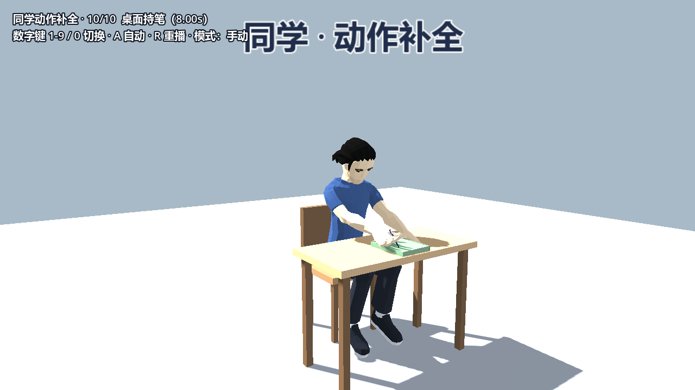
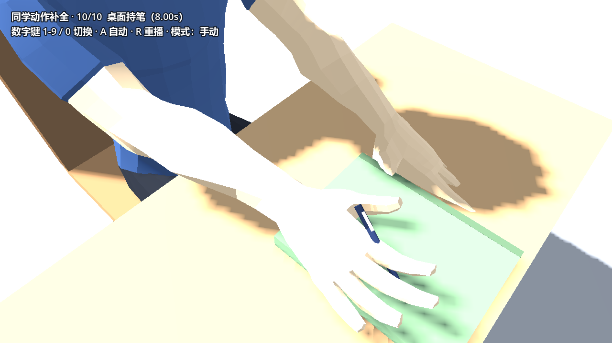

# 同学桌面持笔与四项动作补充（2026-10-26）

- 任务来源：[缺失动作待补充@Yai1024](缺失动作待补充@Yai1024.md)（clcloudy 2026-10-25 提出）
- 负责人：人物负责人（@Yai1024）
- 范围：**动作库 + 预览场景 + 无头测试 + 效果图**。按约定不改
  `scenes/classroom_dialogue.tscn`、`content/classroom_dialogue.json` 与流程脚本；
  课堂内播放需要把事件演员换成 `CharacterAction`，接线方式见第五节。
- 结论：四项全部具备可运行动作。其中「回头 / 捡笔 / 点头」在
  [角色动作补全 24 项](角色动作补全-24项-2026-10-24.md) 已交付，本次核对流程接线并补充断言；
  「桌面持笔」是本次新增的第 25 项动作（`Clip.DESK_PEN_IDLE`）。

## 一、四项对照

| # | 任务原文 | 现状 | 动作 / 位置 | 预览 |
| --- | --- | --- | --- | --- |
| 1 | 同学手放在桌子上，持笔，面前有书 | **本次新增** | `Clip.DESK_PEN_IDLE`（8.0 s 循环） | 同学场景数字键 `0` |
| 2 | 同学们转头向主角方向看（部分同学） | 已交付（24 项 #10） | `Clip.LOOK_BACK`（1.5 s，躯干 18° + 颈 30° + 头 16°，结尾回正） | 同学场景数字键 `4` |
| 3 | 笔掉落，同学侧身捡笔（比较复杂） | 已交付（24 项 #9） | `Clip.PICK_PEN`（4.2 s：侧身弯腰→抓起→放回课本旁→食指轻点→收手）；流程 `events.pen_fall` 另有笔道具坠落/放回补间与「你的笔。」 | 同学场景数字键 `3` |
| 4 | 同学点头 | 已交付（24 项 #8） | `Clip.NOD_FULL`（1.25 s，一次完整点头含轻微回弹） | 同学场景数字键 `2` |

第 2–4 项在 `content/classroom_dialogue.json` 里的接线位置：

| 事件 | 步 | `clips` | 说明 |
| --- | --- | --- | --- |
| 回头 | 5 | `glance_a/b/c` → `LOOK_BACK`，0.4 / 0.9 / 1.4 s 错峰 | 前排三名同学先后转头，不是全班一起转 |
| 捡笔 | 3 | `pen_deskmate` → `PICK_PEN`（0.5 s） | 同事件 `props.pen` 在 0.0 s 坠落、1.8 s 放回 |
| 点头 | 9.1 | `nod` → `NOD_FULL`（0.2 s） | 只在 `confident` 分支触发（E03） |

## 二、第 25 项：桌面持笔

- **姿态**：坐姿、身体略前倾（躯干 8°）、低头看桌面（颈 13°、头 8°），呼吸与轻微书写摆动叠加，
  8 秒循环；不是静止定格。
- **双手**：右手腕在书上前方，手掌摊平、指骨沿笔杆；左手平放在书左侧的桌面。
- **道具**：`PropKit.textbook()` 摊开平放在身前（书心 0.62 m、台面 +0.014 m）；
  `PropKit.pen()` 从指间指向书面落点，**笔尖始终贴在书页上**。
  全部为程序化网格，无新增外部素材。
- **`desk_height` 参数**：动作按课桌台面高度取点。教室课桌台面 **0.775 m**（课桌中心 0.75、厚 0.05），
  因此模板默认 `desk_height = 0.775`；动作预览场景的小桌台面是 0.74，预览脚本里设为 0.74。
  换到别的桌子只需改这一个值，不用重算点位。
- **笔的摆放**：没有沿用通用握持 `_place_in_hand`——它按“手指 + 掌心”合成笔杆方向，
  写字俯角下笔尖会插进书本和桌面 16 cm。改为把笔根放在指间握点、笔杆方向直接指向书面落点，
  笔尖高度由目标点保证（实测笔尖在书面上 0～3 mm）。
- **模板默认**：`scenes/actors/classmate/classmate_animated.tscn` 的默认 `clip` 已设为
  `DESK_PEN_IDLE`，实例化后就是“坐在课桌前写字”的同学，可直接换进教室。

## 三、验证

- [x] `tests/character_actions_check.gd`：**PASS（69 项）**，比之前多 13 项断言。新增覆盖：
  桌面持笔为坐姿（髋高 0.47）、笔和书都出现、双手落在台面高度与身前 0.40–0.72 m 课桌范围、
  笔在右手食指附近、书在身前 0.45–0.80 m 且高度 0.789、低头幅度 > 6°；女性骨架同样通过。
- [x] `tests/dialogue_check.gd`：**PASS**（41 条配音清单、三条分支、0–7 时序未受影响）。
- [x] `tests/smoke.gd`：**PASS**（主流程未受影响）。
- [x] `--headless --editor --import --quit`：零 SCRIPT ERROR。
- [x] 渲染效果图 2 张（`docs/character-actions/25*.png`）：整身构图与手部近景已人工查看，
  书本不悬空、笔尖不穿桌面、左右手不插进书本。
- [ ] 未验证：课堂主场景内的实际播放。原因此次范围只做动作库；课堂座位目前是静态姿态场景
  （`character_pose.gd`），`clips` 会被静默跳过，只剩 `poses` 的静态姿兜底。

## 四、已知限制

1. **低模手指不闭合**：模型没有拇指独立骨控，持笔是“手掌摊平 + 笔从指间穿过”的近似，
   近景能看出笔是贴在手指上的，不是真正捏住。
2. **书是合上的课本网格**：`PropKit.textbook()` 没有展开页，摊开只是平放朝向的近似；
   若要翻开的书页，需要新增一个展开页版本（未做，避免超出本任务）。
3. **动作幅度刻意压小**：满座 42 人时，大幅动作会像抽搐；呼吸与书写摆动都在 1° / 1 cm 量级。

## 五、课堂接入（交给开发）

1. 把要演事件的座位从静态姿态场景换成 `scenes/actors/classmate/classmate_animated.tscn`
   （或复制该模板后设置 `clip` / `outfit` / `desk_height`）。`DialogueFlow` 已经用
   `has_method("play_clip")` 探测，换上去后 JSON 里的 `clips` 自动生效，无需改流程。
2. 模板默认 `clip = DESK_PEN_IDLE`，适合作为课堂默认坐姿；事件开始前不用额外调用。
   一次性动作（`LOOK_BACK` / `PICK_PEN` / `NOD_FULL`）结束后不会自动回坐，
   需要在事件收尾调用 `play_clip(DESK_PEN_IDLE, true)`；流程现有 `poses` 的
   `recover: SIT` 对动画演员只改 `pose` 字段，不会覆盖 `clip`。
3. 教室课桌台面 0.775 m 与模板默认一致；如果换桌子，只改 `desk_height`。
4. 事件演员换成动画演员后，`show_props` 会生成书本/笔。捡笔事件里流程自己也有一支
   `props.pen`，同时存在会出现两支笔——建议事件同桌设 `show_props = false`，
   或删掉 JSON 的 `props.pen` 坠落/放回，二选一。
5. 口型仍是程序化节奏（`teacher_face.gd`），没有与真实配音对齐。
