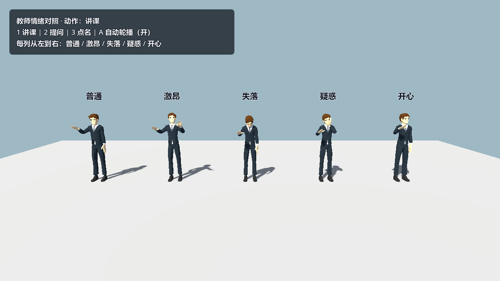
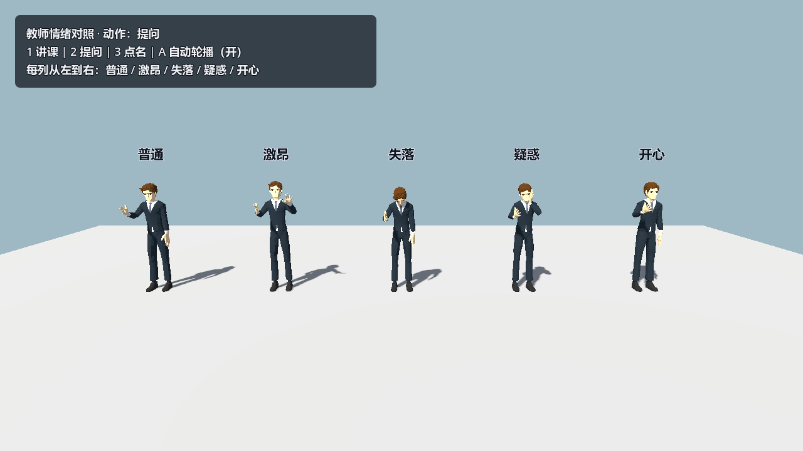
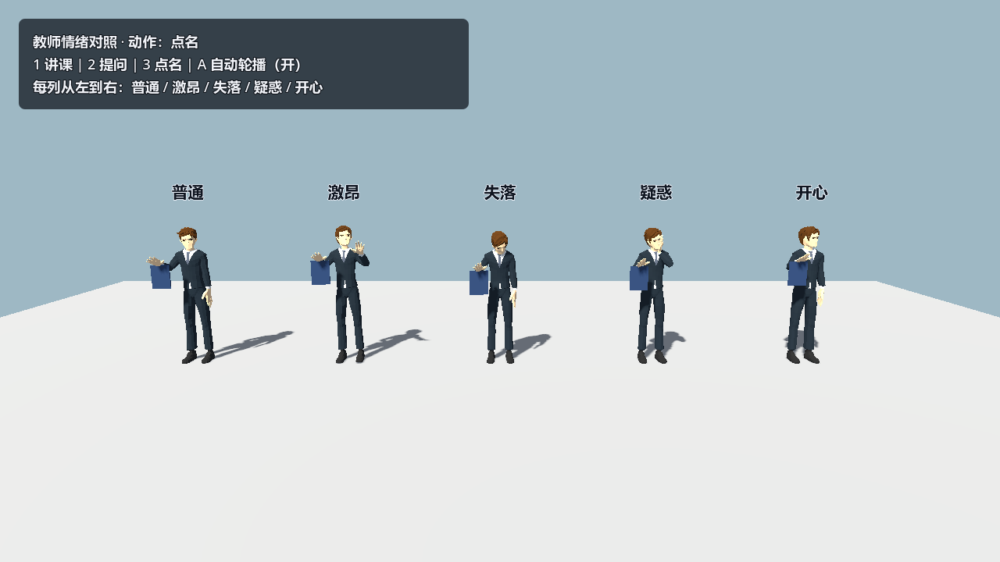
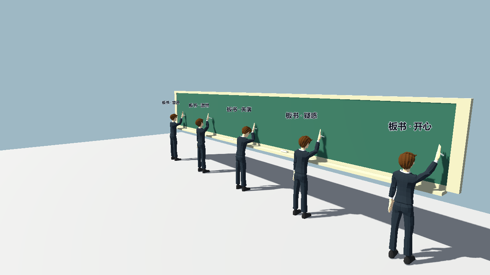
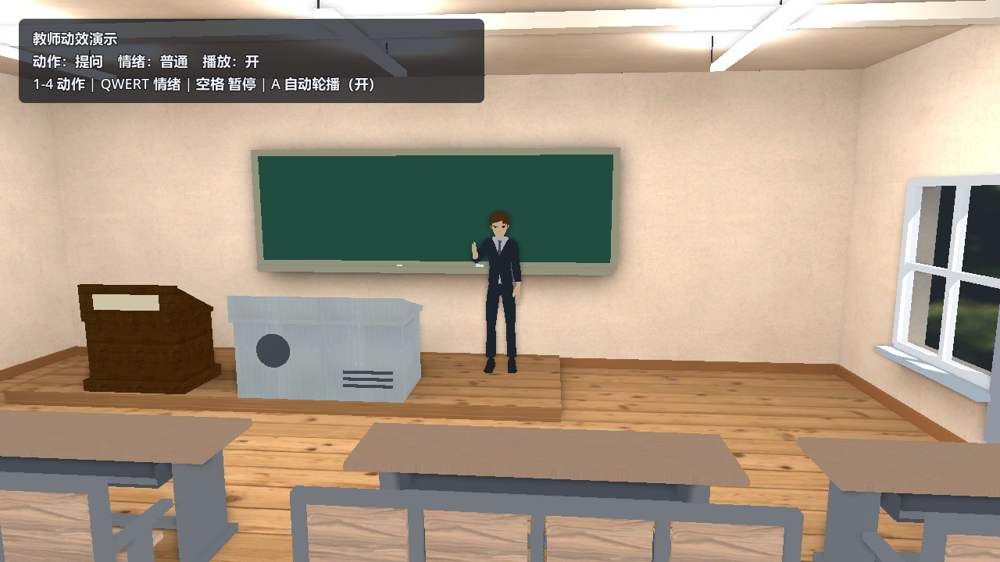
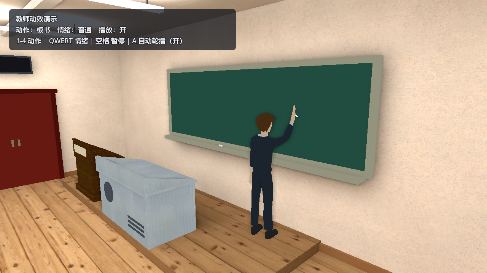

# 教师动作与情绪动效交付（2026-10-23）

- 负责人：@Yai1024（D 人物）
- 任务来源：用户 2026-10-23 要求：教师完成讲课、提问、点名、板书，并叠加激昂、失落、疑惑、普通、开心等情绪，先做一版动效并同步调用说明。
- 状态：**第一版已完成**（动作与情绪可任意组合；可直接接入课堂流程，仍需人工验收观感与节奏）。
- 模型：`assets/characters/quaternius/Suit.glb`（Quaternius，CC0，49 骨）。

## 交付物

| 文件 | 作用 |
| --- | --- |
| `scripts/teacher_animator.gd` | 教师动效控制器：4 动作 × 5 情绪、程序化骨骼动画、两骨 IK、粉笔/点名册道具、黑板对位 |
| `scenes/actors/teacher/teacher_animated.tscn` | 单个动画教师（原教师 `teacher_stand.tscn` 保持不动，静态流程不受影响） |
| `scenes/actors/teacher/teacher_emotions_preview.tscn` | 情绪对照场景：5 名教师并排，1/2/3 切换讲课/提问/点名 |
| `scenes/actors/teacher/teacher_writing_preview.tscn` | 板书对照场景：5 种情绪在黑板上书写 |
| `scenes/actors/teacher/teacher_classroom_preview.tscn` | 真教室集成演示：教师 + 黑板 + 自动轮播 HUD |
| `scripts/teacher_anim_demo.gd` | 课堂演示驱动：自动轮播、键盘切换、HUD 状态 |
| `scripts/teacher_emotion_lineup.gd` | 情绪对照场景驱动：整排切换动作 |
| `tests/teacher_anim_check.gd` | 无画面自检：4×5 组合、道具可见性、转身、黑板对位、三个预览场景装配 |

## 动作（Action）

动作决定身体朝向、右手手势、头部扫描方式，循环播放。

| 动作 | 枚举 | 表现 | 说明 |
| --- | --- | --- | --- |
| 讲课 | `TeacherAnimator.Action.LECTURE`（0） | 面向学生，右手在胸前做开合手势，身体轻微左右摆动，视线缓慢扫视全班 | 默认动作；节奏约 5.5 秒一轮 |
| 提问 | `TeacherAnimator.Action.ASK`（1） | 身体前倾，右手前伸、掌心向上，头略前探 | 像“把问题递给学生”；约 6 秒一轮 |
| 点名 | `TeacherAnimator.Action.CALL_ROLL`（2） | 右手持点名册在胸前，头部左右停留式扫视（不是匀速摆动） | 点名册为运行时生成的低多边形道具 |
| 板书 | `TeacherAnimator.Action.WRITE_BOARD`（3） | 身体转 180° 面向黑板，右手抬到肩上方，粉笔在黑板上来回书写 | 粉笔为运行时道具；转身约 1.2 秒 |

## 情绪（Emotion）

情绪不改变动作目标，只叠加躯干、头颈、手势幅度与节奏；切换时在约 0.4 秒内插值到位。

| 情绪 | 枚举 | 姿态与节奏特征 |
| --- | --- | --- |
| 普通 | `TeacherAnimator.Emotion.NEUTRAL`（0） | 基准姿态，自然幅度 |
| 激昂 | `EXCITED`（1） | 躯干后仰、抬头、双手同时张开、手势更大更快、轻微上下起伏、强调式点头 |
| 失落 | `DOWN`（2） | 躯干前塌、头低下、手势幅度和速度降到约一半、视线偏开 |
| 疑惑 | `PUZZLED`（3） | 歪头、视线偏移，左手托腮（板书动作时不托腮，避免和黑板打架） |
| 开心 | `HAPPY`（4） | 抬头、手势位置略高、轻快点头与上下小跳，节奏加快 |

> 模型没有面部骨骼 / 形态键，情绪完全用身体语言表达；没有口型。

## 怎么调用

### 1. 场景实例化

把 `scenes/actors/teacher/teacher_animated.tscn` 拖进场景即可。根节点原点在地面，**默认面向局部 -Z**；`ViewAnchor` 在 1.7 m。

课堂里学生位于 +Z 方向时，把实例 `rotation_degrees.y` 设为 180，让教师面向学生：

```gdscript
const TEACHER := preload("res://scenes/actors/teacher/teacher_animated.tscn")

var teacher := TEACHER.instantiate()
teacher.position = Vector3(0.9, 0.15, -4.44)
teacher.rotation_degrees.y = 180.0
add_child(teacher)
teacher.set_state(TeacherAnimator.Action.LECTURE, TeacherAnimator.Emotion.NEUTRAL)
```

### 2. 导出属性（编辑器里可调）

| 属性 | 类型 / 默认 | 作用 |
| --- | --- | --- |
| `action` | `Action` = `LECTURE` | 当前动作；编辑器内改值不会平滑过渡，运行时请用 `set_action()` |
| `emotion` | `Emotion` = `NEUTRAL` | 当前情绪；运行时请用 `set_emotion()` |
| `playing` | `bool` = `true` | 关闭后停在当前帧，便于截图/摆拍 |
| `time_scale` | `float` = `1.0` | 整体节奏倍率（激昂情绪内部还会再乘速度系数） |
| `phase_offset` | `float` = `0.0` | 相位偏移（秒），同场景多个教师错开动作 |
| `show_props` | `bool` = `true` | 是否显示粉笔、点名册 |
| `turn_speed` | `float` = `3.5` | 转身插值速度，越大越快 |
| `target_smoothing` | `float` = `12.0` | 手部目标点平滑速度，越小过渡越柔 |

### 3. 运行时方法

| 方法 | 说明 |
| --- | --- |
| `set_action(action: Action, immediate := false)` | 切换动作；`immediate=true` 时转身/手位立即到位（用于硬切） |
| `set_emotion(emotion: Emotion)` | 切换情绪，参数平滑插值 |
| `set_state(action, emotion, immediate := false)` | 同时设置动作与情绪，流程脚本最常用 |
| `cycle_action()` / `cycle_emotion()` | 顺序循环到下一个动作 / 情绪（演示、调试） |
| `get_action_label()` / `get_emotion_label()` | 返回中文名（“讲课”“激昂”等），用于 HUD |
| `apply_pose()` | 立即按当前状态重算一帧姿态（一般不用手动调用） |
| `align_to_blackboard(board: Node3D, distance := 0.47)` | 把教师摆到黑板正面并转向黑板；`y` 保持当前值（讲台高度由场景决定） |

### 4. 信号

```gdscript
teacher.action_changed.connect(func(a: int) -> void: print("动作 -> ", a))
teacher.emotion_changed.connect(func(e: int) -> void: print("情绪 -> ", e))
```

信号在属性改变后发出；`set_action(..., true)` 也会发出。

### 5. 黑板对位（板书必备）

板书手势的目标点在**身体坐标系**里（肩前 0.19 m、肩上 0.30 m），所以教师站位决定粉笔是否碰到黑板：

- 教师 root 到黑板**正面**的水平距离保持 **0.47 m**；
- 教师站在讲台平台上时 `y = 0.15`（真教室前平台高度）；
- 黑板场景约定 **+Z 面朝向教室**，可直接：

```gdscript
teacher.align_to_blackboard($Classroom/Front/Board)  # 自动摆到正面 0.47 m 并转向黑板
```

真教室参考坐标：黑板实例 `(0, 0, -4.94)`，板面厚 0.06 m → 正面 z = -4.91；教师 root `(0.9, 0.15, -4.44)`，root 局部 +Z 指向黑板。

## 演示场景与操作

| 场景 | 操作 |
| --- | --- |
| `teacher_emotions_preview.tscn` | `1` 讲课 / `2` 提问 / `3` 点名；`A` 开关自动轮播（6 秒）。5 列依次是普通/激昂/失落/疑惑/开心 |
| `teacher_writing_preview.tscn` | 无操作，5 种情绪同时板书，便于横向比较 |
| `teacher_classroom_preview.tscn` | `1-4` 讲课/提问/点名/板书；`Q W E R T` 普通/激昂/失落/疑惑/开心；`空格` 暂停/继续；`A` 自动轮播。默认 6 秒换动作、3.5 秒换情绪 |

命令行截图（本机开发工具，不提交）：

```powershell
# 情绪对照：讲课
Godot_v4.6.1-stable_win64_console.exe --path . --script .local/dcheck/preview_shot.gd -- `
  --scene res://scenes/actors/teacher/teacher_emotions_preview.tscn --frames 130 --action 0 `
  --cam 0,2.6,8.2 --look 0,1.1,0 --out teacher_emotions_a0
```

## 课堂流程接入建议

以 `docs/10.22(very important).md` 的对话段为例：

| 剧情节点 | 建议调用 |
| --- | --- |
| 开场在黑板上写下“坚持” | `set_state(WRITE_BOARD, NEUTRAL)`；写完转回来 |
| 放下粉笔、看向主角 | `set_state(LECTURE, NEUTRAL)`；转身约 1.2 秒，正好覆盖“放下粉笔”的动作 |
| “换成你，你觉得这时候还应该继续吗？” | `set_state(ASK, PUZZLED)` 或 `ASK, EXCITED`（取决于老师语气） |
| 点名/环视全班 | `set_state(CALL_ROLL, NEUTRAL)` |
| “放弃当然也能说出放弃的道理……” | `set_state(LECTURE, NEUTRAL)`；讲到关键句可切 `EXCITED` |
| 学生回答失败后的收束 | `set_state(LECTURE, DOWN)`，语速与手势同步放慢 |

- 每句台词开始前调用一次 `set_state()` 即可，动作本身会持续循环。
- 同一动作只换情绪时调用 `set_emotion()`，不会打断手部动作。
- 情绪插值约 0.4 秒、转身约 1.2 秒；需要“镜头一切就到位”时才用 `immediate=true`。
- 说话时长参考任务三文档（老师开场 6~7 秒、追问 17~20 秒等）。

## 技术说明

- **纯程序化动画**：每帧从 rest 重建 49 根骨骼，再叠加躯干/头颈角度、两骨 IK 和道具变换；不依赖 AnimationPlayer、不烘焙轨道，任意 Quaternius 骨架通用。
- **动作 + 情绪分层**：动作决定朝向、手势目标、头部扫描；情绪只改姿态参数与节奏，因此 4×5 组合全部可用。
- **平滑切换**：情绪参数 `1-exp(-5Δt)` 插值；手部目标点按 `target_smoothing` 插值；身体转向用 `lerp_angle` 按 `turn_speed` 插值。
- **两骨 IK**：由肩位、目标点、臂长解出肘位（极向指向外下方），再依次瞄准上臂/前臂；手骨再用中指骨作为“手指方向”定向，必要时绕手指轴滚动手腕（提问的掌心向上）。
- **道具**：粉笔与点名册是脚本生成的 `BoxMesh`，每帧按右手骨世界位置摆放；不引用外部素材。
- **性能**：单个教师每帧约 49 次骨骼写入 + 一次 IK，开销很小；满座同学仍用静态 `character_pose.gd`，不会被带动。若未来同屏出现大量动画教师，可把 `process` 降到 30 Hz。

## 已知限制

- ~~无面部表情、无口型 / 视位；情绪只靠身体语言。~~ 2026-10-23 已补：见[教师口型与握持](教师口型与握持-2026-10-23.md)。
- ~~手指不单独弯曲，粉笔/点名册是近似握持~~ 2026-10-23 已补：五指按掌宽轴逐节弯曲，道具按弯曲后的指骨位置夹持（同上文档）。
- 板书只有书写动作，不会在黑板材质上留下字迹（如需“写字留痕”，后续可加贴花或 Line3D 轨迹）。
- 教师只原地转身，不走路；从讲台走到黑板需场景层做位移。
- 板书书写高度约 1.65~1.8 m，适合现有黑板的下半部分；若黑板位置更高，需要调整 `WRITE_BOARD` 的目标高度。

## 验证记录（Godot 4.6.1 标准版）

- [x] headless 导入新脚本/场景，零错误。
- [x] `tests/teacher_anim_check.gd` 通过：
  - 4 动作 × 5 情绪全部切换，手部目标有效；
  - 粉笔仅在板书显示、点名册仅在点名显示；
  - 板书转身 180°、讲课回正；
  - `align_to_blackboard` 距离与朝向正确；
  - 三个预览场景可实例化，教师数量正确。
- [x] `tests/smoke.gd` 通过（主场景流程未受影响）。
- [x] 渲染检查（截图见下）。
- [ ] 待人工验收：完整对话流程中的动作切换节奏、与台词/配音的配合。

## 效果图

### 讲课 × 五种情绪



### 提问 × 五种情绪



### 点名 × 五种情绪



### 板书 × 五种情绪



### 真教室集成：提问



### 真教室集成：板书



## 素材与授权

- 教师模型沿用 `CHAR-001`：`Suit.glb`，Quaternius，CC0 1.0，许可全文在 `assets/characters/quaternius/`。
- 粉笔、点名册为运行时 `BoxMesh`，无外部素材；无新增字体、贴图或音频。
- 未修改 `.glb` 源文件。
