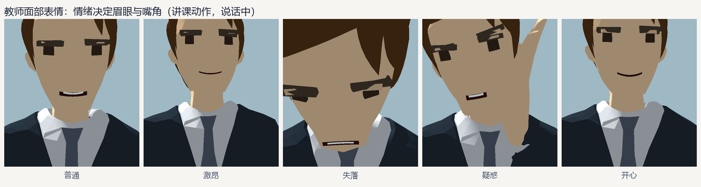
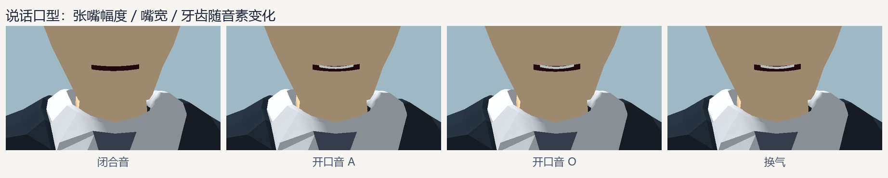
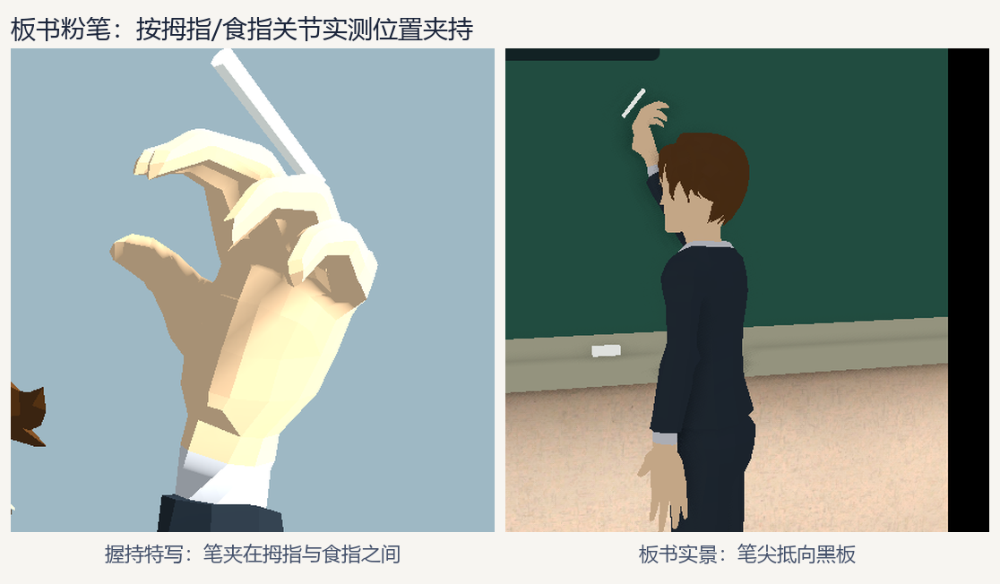
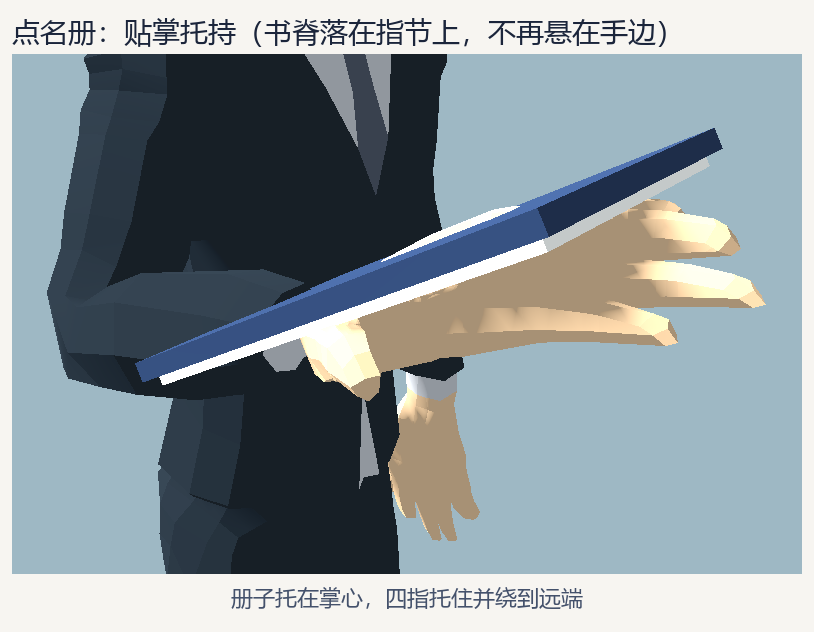
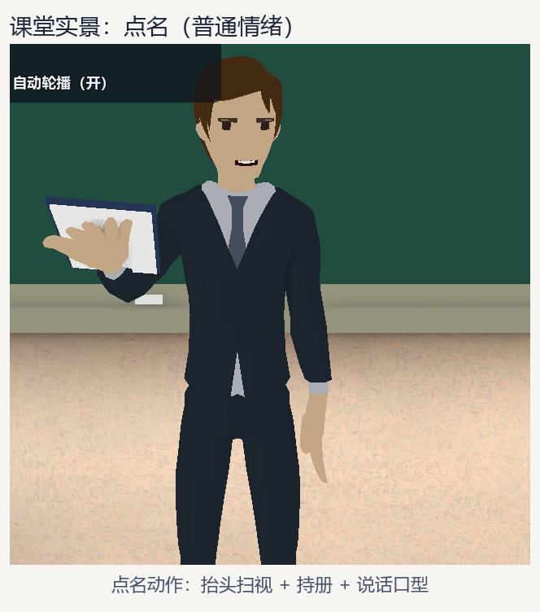

# 教师口型与握持（2026-10-23）

承接《教师动作与情绪动效》（2026-10-23）：补上原版明确遗留的两项——
**面部表情 / 说话口型** 与 **粉笔、点名册的真实握持**。

- 代码：`scripts/teacher_face.gd`（新增，`TeacherFace`）、`scripts/teacher_animator.gd`（改）
- 测试：`tests/teacher_anim_check.gd`（扩充）
- 效果图：`docs/teacher-anim/07~11`
- 无新增外部素材：面部面片与道具全部为运行时生成的网格。

---

## 一、问题

Quaternius 人物的脸只有四个面：`Skin`、`Hair`、`Eyebrows`、`Eye`，**没有嘴**，骨架里**没有下颌骨**，网格**没有 blend shape**。所以口型既不能靠 morph target，也不能靠开合下巴，只能“画”出来。

原版粉笔/点名册是按 `hand + fwd*0.09 + up*0.095` 这类固定偏移摆的，而手的朝向随时在变——结果道具浮在手边，手指还是张开的。

## 二、面部：从头部网格量出来，再贴三层面片

`TeacherFace.setup()` 在 `_ready` 时读取 `*_Head` 网格（当前是 `Suit_Head`），把所有顶点换算到**头骨局部坐标**，一次性测出：

| 测量项 | 来源 | 用途 |
| --- | --- | --- |
| 下巴高度 `chin_y` | `Skin` 顶点最小 y | 定嘴的高度 |
| 眼框矩形 | `Eye` 面片按 x 正负分成左右 | 定眼睑尺寸、嘴的高度与宽度 |
| 眉毛三角形 | `Eyebrows` 面片的三角形按重心分左右 | 复制成可动眉毛面片 |
| 脸部深度 | 眼框前沿 z | 定嘴/眉/眼睑的贴面深度，避免浮在脸前 |

嘴的位置：`y = chin + 0.56 × (眼线 − chin)`，宽度取两眼中心距的 0.6 倍（实测 5.3 cm）。整张脸的 `z` 最大值会取到鼻尖/额头，直接用会让嘴浮在外面前面，所以贴面深度一律以眼框前沿为基准。

> 这套测量只要求模型头部网格以 `_Head` 结尾、眼睛材质名以 `Eye` 开头；换 Quaternius 其他服装模型可直接用，测不到会退回内置比例。

### 1. 嘴：音素驱动的开合

嘴是两排顶点组成的“透镜”网格（16 段），每帧按当前口型重建：

- 上缘 = `打开高度 × 0.34 + 笑意曲线`，下缘 = `−打开高度 × 0.66 + 笑意曲线`；
- 笑意曲线为抛物线，嘴角随情绪上扬/下垂；
- 开口大于 22% 时在口腔上缘画出牙齿条。

口型表 `VISEMES` 共 9 项（A / E / I / O / U / M·B·P / F·V / S·Z / 换气），每 0.07~0.15 秒换一次（受 `speech_speed` 与情绪速度影响），插值分两档：闭合音收得快、开口音张得利落，避免嘴一直半张。

| 情绪 | 笑意 | 口型幅度 | 语速 |
| --- | --- | --- | --- |
| 普通 | 0.12 | 1.00 | 1.00 |
| 激昂 | 0.45 | 1.22 | 1.45（含身体节奏） |
| 失落 | −0.42 | 0.72 | 0.70 |
| 疑惑 | −0.05 | 0.90 | 0.90 |
| 开心 | 0.62 | 1.05 | 1.05 |

说话由动作决定：讲课 / 提问 / 点名说话，板书（已背对教室）自动闭嘴；`talking = false` 可整体关闭。

### 2. 眉：复制原模型面片

直接把 `Eyebrows` 面的三角形复制成独立网格，绕重心放大 1.12 倍、沿平均法线外移 1.5 mm 盖住原眉毛，再按情绪整体平移 + 绕脸法线旋转：

- 正值 = **眉内侧上挑**（失落、犹豫）；负值 = 眉内侧下压（激昂、疑惑）。
- 疑惑额外把一侧眉毛抬高 6 mm，做出“单边挑眉”。

### 3. 眼睑：肤色面片上眼睑下落

眼睛是平的贴片，所以眼睑就是一块对齐眼睛上缘的肤色四边形，`y` 方向按比例缩放实现“从上往下合上”：

- 眨眼：2~5 秒随机一次，0.09 秒闭合 + 0.09 秒睁开（用实例 id 播种，多个教师不同步）；
- 眯眼：失落 0.34、疑惑 0.16、开心 0.30、普通 0.10、激昂 0.04。





## 三、握持：用指骨算坐标系，再夹道具

### 手掌坐标系（`_hand_frame`）

```
finger = 指根四点(Index2/Middle2/Ring2/Pinky2) 平均 − Hand
thumb  = Thumb2 − Hand
palm   = 右手: thumb × finger   左手: finger × thumb
```

`palm` 的叉积顺序是这次调试踩到的关键：右手掌心朝上、手指前伸时**拇指在小指一侧的外侧**（旋后），所以掌法线 = 拇指 × 手指。顺序写反时整个手掌会转过 180°，道具会贴到手背上。

### 手指弯曲（`_curl_fingers`）

绕 `palm × finger` 轴逐节弯曲，四指按 `FINGER_CURL`（近节 1.0 / 中节 1.05 / 远节 0.8）弯向掌心，拇指再对掌压过来。不同握法用 `HOLD_SCALES` 分工：

| 握法 | 食指 | 中指 | 无名指 | 小指 | 拇指 |
| --- | --- | --- | --- | --- | --- |
| 捏粉笔 `pinch` | 0.92 | 1.00 | 1.16 | 1.22 | 1.45 / 1.25 |
| 托名册 `hold` | 0.82 | 0.88 | 0.95 | 1.00 | 1.20 / 1.10 |

各动作的弯曲量：讲课 0.18、提问 0.12、点名 0.12、板书 0.72（×55°为基准角）。手指弯曲前先把手掌坐标系存进 `_grip_frame`——弯曲后指根会转，再用弯曲后的坐标算道具就会偏。

### 粉笔

- 捏点：**食指近节与中节中点，再往掌心侧 1.2 cm**（拇指再弯也够不到食指时，笔也不会浮在虎口外）。
- 笔轴：`手指 × 0.70 + 掌心 × 0.38`，即沿手指方向、略向掌心外撇。
- 笔身：直径 1.5 cm、长 11 cm 的八棱柱，重心放在捏点前 5.5 cm——笔尖露出约 10 cm。

### 点名册

- 册面法线 = 掌心法线，长边顺手指方向（书脊朝掌心）。
- 册子背面高度取**四指各节与指尖离掌平面的最高点 + 4 mm**，所以手指不会穿出封面。
- 册子中心再沿手指前移 9 cm，使远端书脊正好落在指尖处，看起来是“托住”而不是“顶在手心”。







## 四、接口变化

`TeacherAnimator` 新增导出属性：

| 属性 | 默认 | 说明 |
| --- | --- | --- |
| `talking` | `true` | 说话口型开关；板书动作自动闭嘴 |
| `speech_speed` | `1.0` | 口型语速倍率 |

运行时不需要额外调用；演示场景 `teacher_classroom_preview.tscn` 新增 `S` 键开关说话，HUD 同步显示。

## 五、验证（Godot 4.6.1 标准版）

- `--headless --editor --import --quit`：零 SCRIPT ERROR / 解析错误。
- `tests/teacher_anim_check.gd`：PASS
  - 4 动作 × 5 情绪全部切换，粉笔/点名册与手的距离在握持范围内；
  - 面部节点与嘴/双眉/双眼睑面片都生成，嘴宽由头部网格实测；
  - 说话时嘴最大开合 > 0.45 且形状随音素变化；`talking=false` 后 60 帧内闭合；
  - 失落时眼睑比激昂更闭合（眯眼）；
  - 握粉笔时手指确实弯曲、粉笔落在食指捏点；点名册在掌侧且不悬空。
- `tests/smoke.gd`：PASS（主流程未受影响）。
- 人工检查：`docs/teacher-anim/07~11` 用真实渲染截图核对面部与握持；课堂距离下口型与持册动作可辨。

## 六、已知限制

- 嘴和眼睑是**贴面片**，侧脸角度过大时会看到片状边缘（现有镜头角度内不明显）。
- 口型是按“音素序列”节奏生成的，不对应真实台词音频；如需对齐配音，可把 `VISEMES` 索引按时间轴写死或接音素表。
- 眉毛是复制原面片放大盖住原眉，极端挑眉仍可能露出原眉边缘；幅度已限制在 6 mm / 12° 内。
- 手指只做整指弯曲，没有单独控制某一指的接口（当前动作不需要）。
- 面部贴片按头骨局部坐标跟随，未参与骨骼蒙皮；若以后给模型换头或加表情 blend shape，这层可以整体去掉。
