# 角色动作补全（缺失动作 1~24）交付记录

- 日期：2026-10-24
- 负责人：人物负责人（@Yai1024）
- 依据：[任务五课堂对话流程与镜头](任务五课堂对话流程与镜头-2026-10-24.md) 第六节「缺失动作清单」，
  以及 [10.22 任务书（补充六个事件）](<10.22(very important)_补充六个事件.md>)
- 结论：**清单 1~24 全部完成**，每项都有可运行动作与效果图。全部为运行时程序化动画/建模，
  没有新增外部模型、动画或贴图素材。
- 2026-10-26 追补：新增第 25 项「桌面持笔」（`Clip.DESK_PEN_IDLE`），见
  [同学桌面持笔与四项动作补充](同学桌面持笔与四项动作补充-2026-10-26.md)。

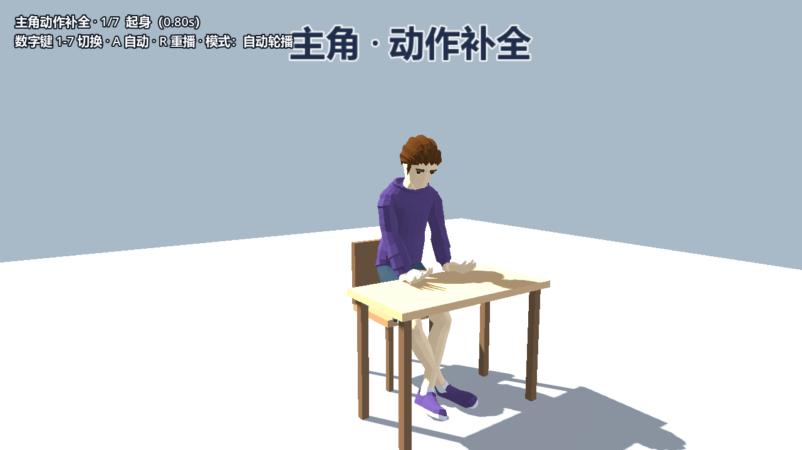

## 一、怎么直接看

四个独立预览场景，互不依赖课堂流程，可单独运行：

```bat
Godot_v4.6.1-stable_win64_console.exe --path . res://scenes/actors/protagonist/protagonist_actions_preview.tscn
Godot_v4.6.1-stable_win64_console.exe --path . res://scenes/actors/classmate/classmate_actions_preview.tscn
Godot_v4.6.1-stable_win64_console.exe --path . res://scenes/actors/teacher/teacher_extra_preview.tscn
Godot_v4.6.1-stable_win64_console.exe --path . res://scenes/actors/props/props_preview.tscn
```

| 场景 | 操作 |
| --- | --- |
| 主角 | 数字键 1~7 切换动作，A 自动轮播，R 重播 |
| 同学 | 数字键 1~9 切换动作，A 自动轮播，R 重播 |
| 教师 | 数字键 1~5 切换动作，A 自动轮播，R 重播 |
| 道具 | 静态展示，直接查看 |

可复用的人物模板：`scenes/actors/protagonist/protagonist_animated.tscn`、
`scenes/actors/classmate/classmate_animated.tscn`。把场景放进教室后，运行时调用
`play_clip()` 即可。

## 二、24 项对照表

| # | 缺失动作 | 实现 | 预览动作 | 效果图 |
| --- | --- | --- | --- | --- |
| 1 | 主角起身/坐下连贯动作 | `SIT_TO_STAND` / `STAND_TO_SIT`：腿折叠角度、髋高、躯干前倾与手撑膝同步过渡，0.80/0.85 s | 主角 1、2 | [起身](character-actions/01-protagonist-stand-up.png) · [坐下](character-actions/02-protagonist-sit-down.png) |
| 2 | 主角说话口型与表情 | 复用 `TeacherFace` 实测面片；`speaking` 驱动 9 视素口型，`EXPRESSIONS` 提供自信/紧张等 7 组表情 | 主角 3 | [说话+口型](character-actions/03-protagonist-talk-face.png) |
| 3 | 站立说话手势循环 | `STAND_TALK`：右手张开掌心朝听者、缓慢开合，左手自然下垂，重心左右移，4 s 循环 | 主角 3 | 同上 |
| 4 | 四处看循环 | `LOOK_AROUND`：3 个视线落点（-36° / +28° / 回正），两端停留，7.4 s 循环，双手腰前轻扣 | 主角 4 | [四处看](character-actions/04-protagonist-look-around.png) |
| 5 | 扶桌边 + 手慢慢收回 | `HAND_ON_DESK` 手掌压桌面；`HAND_RETRACT` 1.4 s 从桌边收回到腿上 | 主角 5、6 | [扶桌边](character-actions/05-protagonist-hand-on-desk.png) · [收回](character-actions/06-protagonist-hand-retract.png) |
| 6 | 输入回答时的站立细节 | `STAND_INPUT`：双手腰前轻扣、重心缓慢移动、低头看输入框并周期性抬眼看老师，10 s 循环 | 主角 7 | [站立输入](character-actions/07-protagonist-input-stance.png) |
| 7 | E02 低笑：肩膀轻动 | `LAUGH_SHAKE`：右手横在嘴前（按实测嘴面片定位，留 4.5 cm 余量）、手指横向掠过嘴唇，躯干/肩以 17 rad/s 抖动并在 1.15 s 内衰减 | 同学 1 | [掩嘴低笑](character-actions/08-classmate-laugh.png) |
| 8 | E03 完整点头 | `NOD_FULL`：一次完整点头（含轻微二次回弹），1.25 s 回正 | 同学 2 | [点头](character-actions/09-classmate-nod.png) |
| 9 | 弯腰捡笔连贯动作 | `PICK_PEN`：侧身弯腰 → 抓笔 → 起身放回课本旁 → 食指轻点 → 收手，4.2 s；笔道具随手移动 | 同学 3 | [弯腰](character-actions/10-classmate-pick-pen-bend.png) · [放回](character-actions/11-classmate-pick-pen-place.png) |
| 10 | 抬眼回头看向主角 | `LOOK_BACK`：躯干 18°、颈 30°、头 16° 转头并抬下巴，1.5 s，画面里只见侧脸 | 同学 4 | [回头抬眼](character-actions/12-classmate-look-back.png) |
| 11 | 看着黑板轻轻摇头 | `HEAD_SHAKE`：面朝前方、2.4 次左右摇头并回正，配合皱眉表情 | 同学 5 | [摇头](character-actions/13-classmate-head-shake.png) |
| 12 | 低头画小方格 + 擦线 | `DRAW_GRID`：右手持铅笔在本子上画小方格，5.2 s 循环中左手拿橡皮擦掉一条线；配本子/铅笔/橡皮道具 | 同学 6 | [画方格](character-actions/14-classmate-draw-grid.png) · [擦线](character-actions/15-classmate-erase.png) |
| 13 | 前排把抬起的课本放低 | `LOWER_BOOK`：双手托书在胸前 → 降到桌面 → 松手，2.2 s；课本道具跟随双手 | 同学 7 | [放低课本](character-actions/16-classmate-lower-book.png) |
| 14 | 交头接耳循环 | `WHISPER_LOOP`：躯干/颈/头转向邻座、头部微动、说话时抬右手掩在嘴边，3.4 s 循环，含说话/停顿分段 | 同学 8 | [交头接耳](character-actions/17-classmate-whisper.png) |
| 15 | 交头接耳 → 忽然安静 | `QUIET_SETTLE`：0.55 s 从侧身转回前方、手放下、嘴闭合 | 同学 9 | [忽然安静](character-actions/18-classmate-quiet.png) |
| 16 | 同学低声说话口型 | `CharacterAction` 内置 `TeacherFace`；`WHISPER_LOOP` 按说话段自动开合，其他动作可 `speaking=true` | 同学 8 | 同 [交头接耳](character-actions/17-classmate-whisper.png) |
| 17 | 放下粉笔的收尾动作 | 教师 `CHALK_DOWN`：从黑板前转身，右手把粉笔送到讲台粉笔盒，1.6 s；粉笔在 70% 处消失 | 教师 1 | [放下粉笔](character-actions/19-teacher-chalk-down.png) |
| 18 | 将课本放到讲台 | 教师 `BOOK_PLACE`：双手持书 → 降到讲台 → 松手，2.0 s；课本留在讲台 | 教师 2 | [放课本](character-actions/20-teacher-book-place.png) |
| 19 | 明确“点到你”手势 | 教师 `POINT`：整臂伸向 `point_target`，只伸食指、其余手指收起，头微抬 | 教师 3 | [指向你](character-actions/21-teacher-point.png) |
| 20 | 讲台 ↔ 黑板走路 | 教师 `WALK` + `walk_to()`：原地走路循环（腿摆、手臂反向摆、髋部起伏）叠加带缓起缓停的位移，到点自动切回讲课 | 教师 4 | [走路](character-actions/22-teacher-walk.png) |
| 21 | 讲课中翻课本 | 教师 `BOOK_FLIP`：左手持书，右手两次捏页角从左向右翻，书页网格绕书脊旋转，2.6 s | 教师 5 | [翻课本](character-actions/23-teacher-book-flip.png) |
| 22 | 笔（桌边滚落那支） | `PropKit.pen()`：笔杆 + 笔帽 + 笔夹 + 笔尖，0.142 m | 道具 / 同学 3 | [道具](character-actions/24-props.png) |
| 23 | 讲台课本、粉笔盒 | `PropKit.textbook()`、`PropKit.chalk_box()`：封面/书页/书脊、浅口纸盒 + 3 根粉笔 | 教师 1、2 / 道具 | [道具](character-actions/24-props.png) |
| 24 | 画方格同学的铅笔/橡皮/本子 | `PropKit.pencil()`、`PropKit.eraser()`、`PropKit.notebook()`：六棱笔杆 + 木尖 + 石墨芯、橡皮、横格本 | 同学 6 / 道具 | [道具](character-actions/24-props.png) |

## 三、主角（1~6）

### 1. 起身 / 坐下

坐姿腿角（大腿 -90°、小腿 110°）与站立 rest 之间插值，同时把模型整体落到
`lerp(0.47, 站立髋高)`；躯干在前半程前倾、手撑膝，后半程回到站姿。下行同理，
手先扶膝再收到腿上。髋高与腿角同步，因此不会出现“腿站直了人还坐着”的跳变。


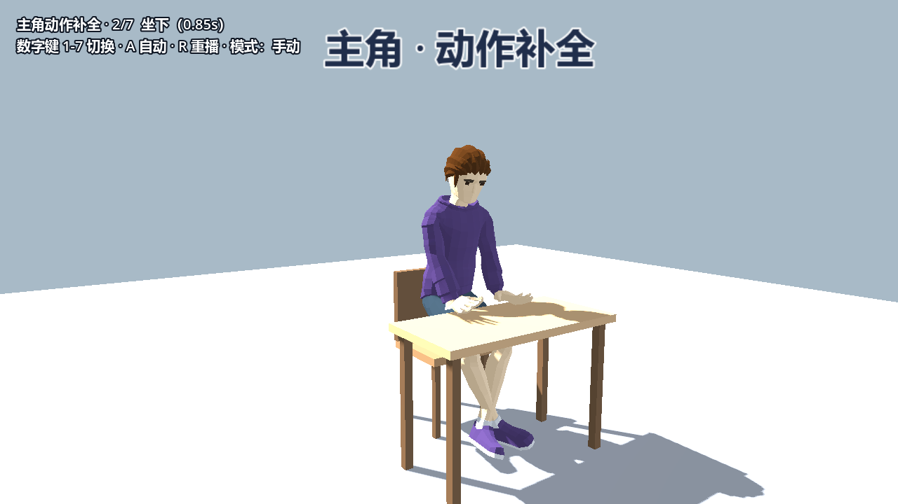

### 2~3. 说话口型、表情与手势

`TeacherFace` 在模型头部网格上实测眼框、眉片、下巴，贴出嘴、牙、眉、眼睑四组面片；
`CharacterAction` 每帧把嘴的开合/宽度/笑意、眉高、眉倾、眯眼传入。
`EXPRESSIONS` 预设：`neutral / confident / nervous / warm / amused / focused / doubt`。

`STAND_TALK` 的右手掌心朝向讲台（听者），手指自然向上张开，手臂在胸前小幅开合；
左手自然下垂，头部朝讲台方向并轻微扫视。口型由 `speaking` 控制，截图取在张口帧。

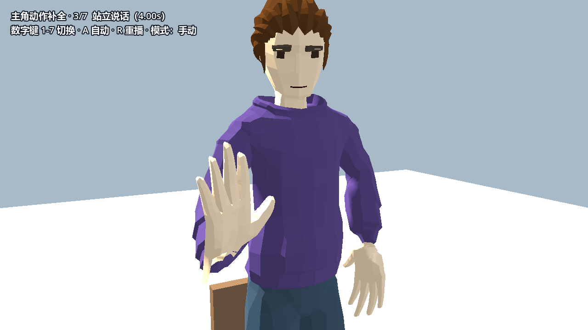

### 4. 四处看

7.4 s 循环，视线落点：左后方 -36°（停留 1.2 s）→ 右前方 +28°（停留 1.2 s）
→ 回正。躯干只跟随 22%，颈 55%，头 30%，看起来像“用眼睛躲”，而不是整个人转过去。
双手在腰前轻扣，重心随视线轻微移动。

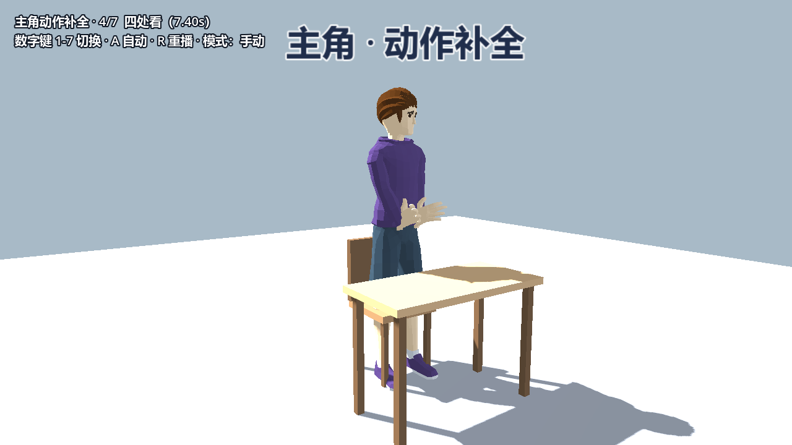

### 5. 扶桌边与手收回

`HAND_ON_DESK`：右手 IK 到桌面前缘（前 0.36 m、右 0.16 m、高 0.755 m），掌心向下、
五指自然分开；左 hand 放在腿上。`HAND_RETRACT` 在 1.4 s 内用 smoothstep 把手从桌边
移回腿上，躯干同时回正、手指放松。

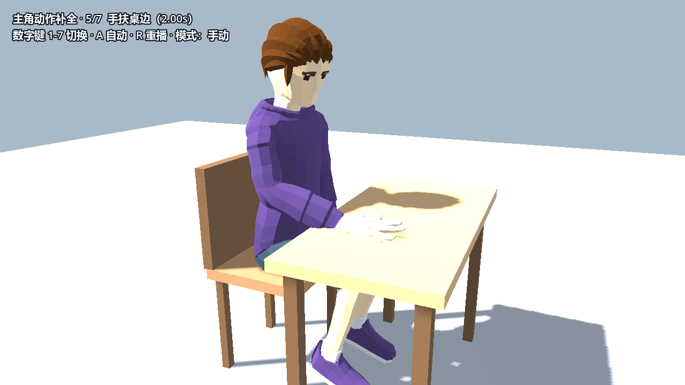
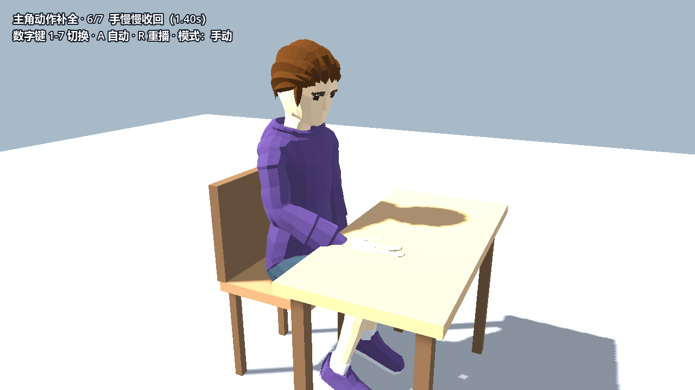

### 6. 输入回答时的站立细节

10 s 循环：双手在腰前轻扣，重心缓慢左右移；头部按 10 s 关键帧低头看输入框、
抬头看老师（-14° / +13° 两次），配合轻微呼吸起伏。

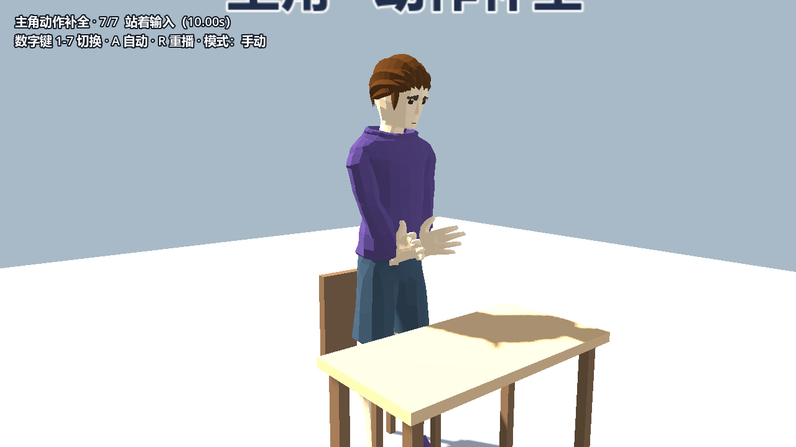

## 四、同学（7~16）

演示统一用 Casual2 + 3 号便装配色，短发便于看清手部；动作本身对男女骨架通用
（自动检查另外用 WomensCasual 跑了起身、低笑、交头接耳、点头四项）。

### 7. 掩嘴低笑

右手横在嘴前、掌心朝嘴、手指横向掠过嘴唇（0.72 握持），躯干与肩以 17 rad/s 抖动，
1.15 s 内衰减到静止；头略低，表情带笑意。手位以 `TeacherFace` 实测的嘴面片为基准，
手腕再向前留 4.5 cm，避免手骨原点是手腕、手指又向上伸展时插进头部。
相对原来的 `COVER_MOUTH` 静态姿，多了“肩膀轻动两下”的过程。

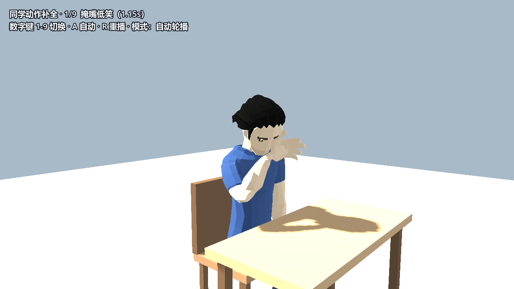

### 8. 完整点头

一次 17° 的主点头 + 3° 的二次回弹，1.25 s 回到原位；躯干只前倾 2°，避免整个人在鞠躬。

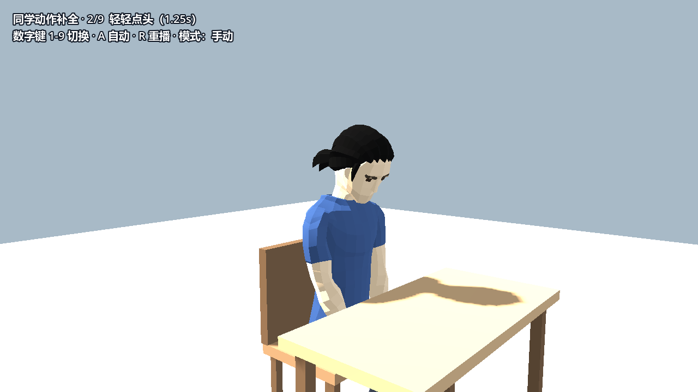

### 9. 弯腰捡笔

4.2 s 时间轴：侧身弯腰（躯干侧倾 48°、略前倾）→ 右手到地面抓笔 → 起身把笔放到
课本旁 → 食指伸出轻点一下 → 收手。笔道具按 `u` 在“地上 → 手里 → 桌面”三段之间切换。
弯腰方向朝座位右侧，避开课桌，不会出现脸埋进桌面的穿模。

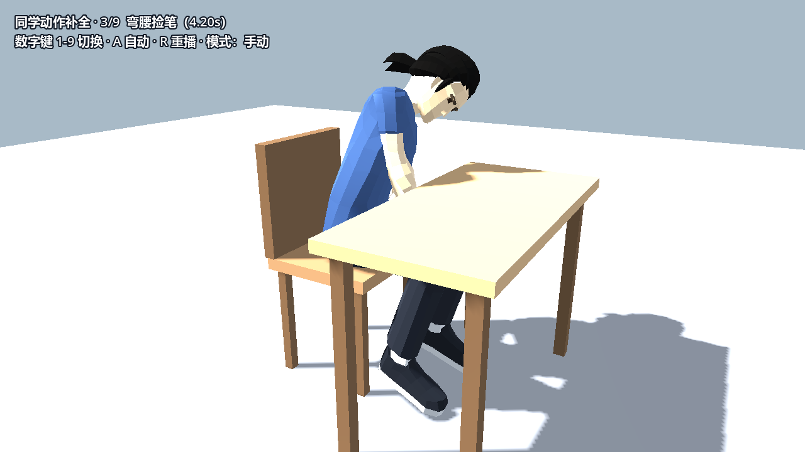
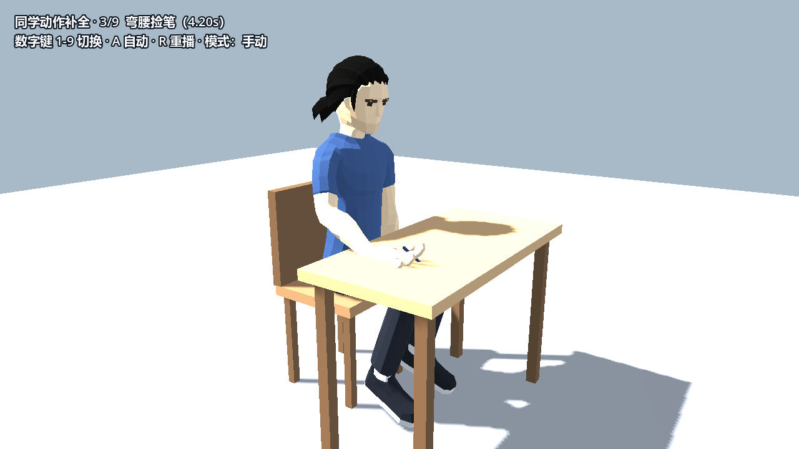

### 10. 回头抬眼

躯干 18°、颈 30°、头 16°，下巴略抬（-4°），1.5 s 内转过去、停住、转回。
从正面机位只能看到侧脸，符合“同桌只能看见侧脸”。

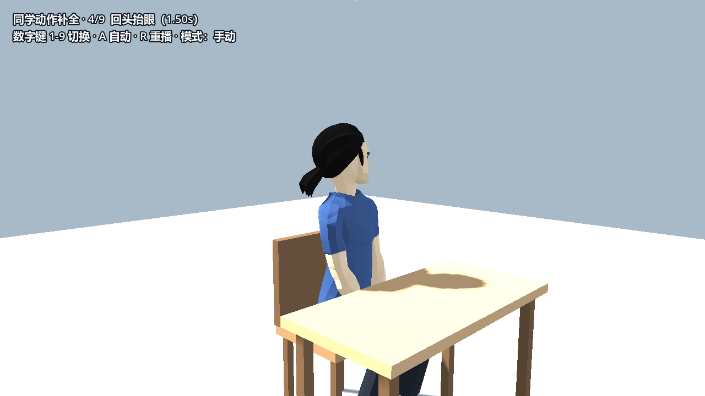

### 11. 看着黑板摇头

面朝前方、下巴略抬，头部在 2.4 个周期内左右各 12° 摇头，末尾回正；
表情使用 `doubt`（眉内侧下压、轻眯眼），表示不同意而不是走神。

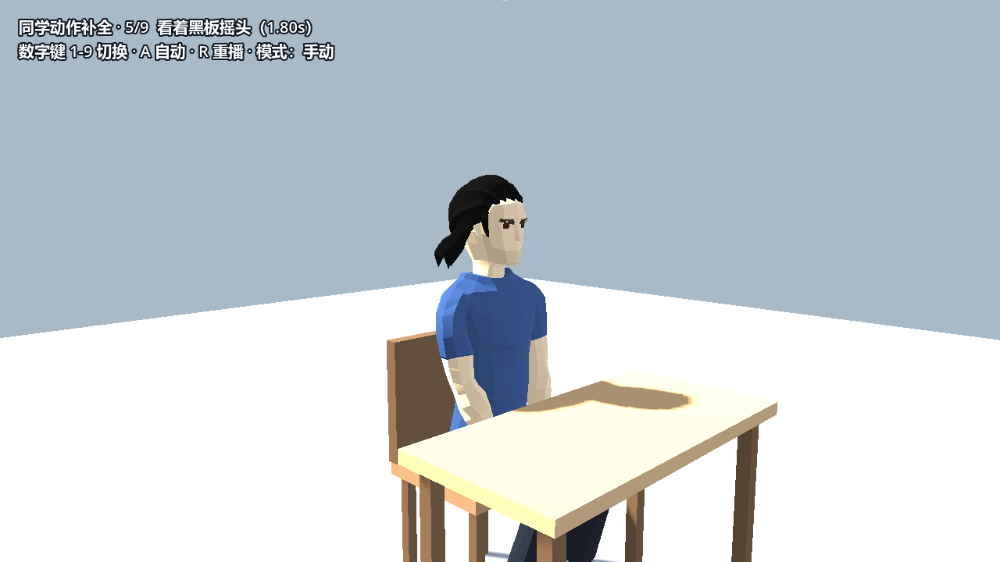

### 12. 画小方格 + 擦线

5.2 s 循环。右手捏铅笔，在桌面本子上按两个不同频率的正弦合成小范围锯齿轨迹
（画方格）；循环后段左手拿橡皮移到某条线上擦一下再回位；头随右手轻微移动。
本子、铅笔、橡皮都是 `PropKit` 程序化道具。

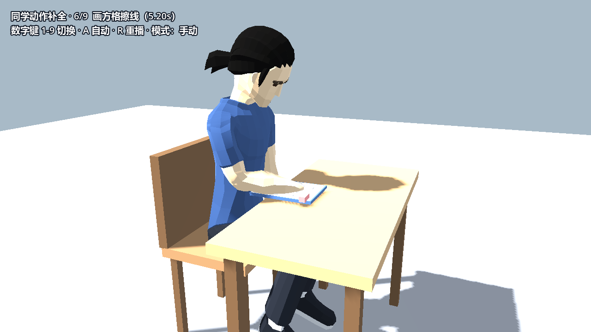
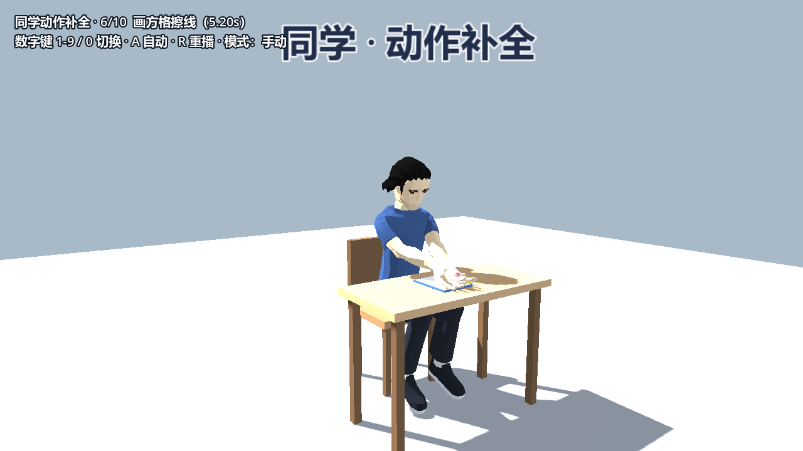

### 13. 放低课本

双手托住课本两侧（掌心相对），从胸前降到桌面，最后 18% 松手回到腿上；
课本道具跟随双手中心，落到桌面高度。2.2 s。


### 14~15. 交头接耳循环与忽然安静

`WHISPER_LOOP` 3.4 s：躯干 8°、颈 24°、头 10° 转向邻座（`whisper_side` 可设左右），
身体随说话节奏轻微前倾；说话段（0~1.65 s）抬右手掩在嘴边，停顿段手放下。
`QUIET_SETTLE` 0.55 s 从侧身转回前方、双手放下、嘴闭合，可接在原循环任意位置。

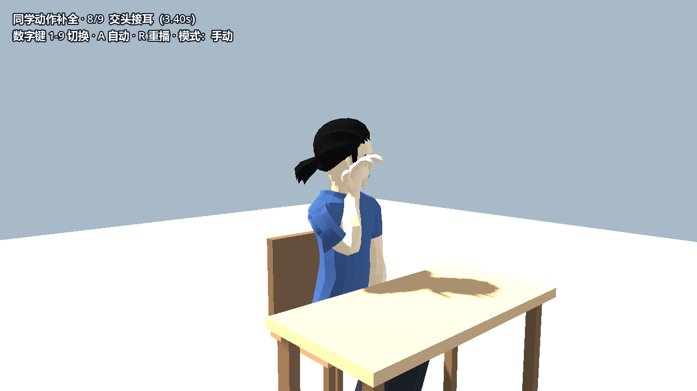
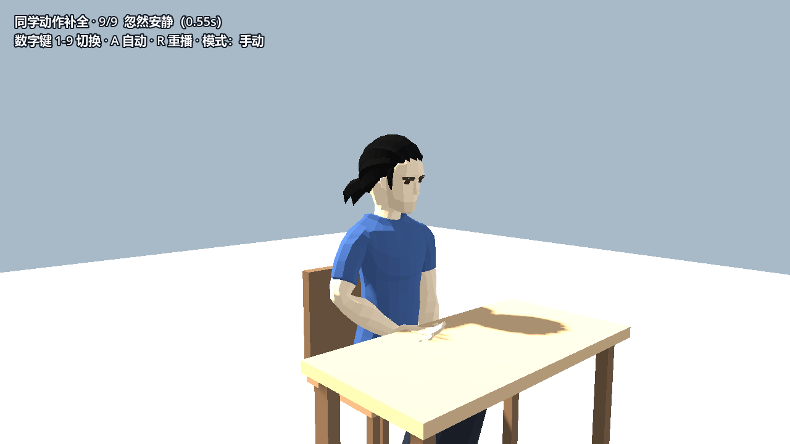

### 16. 同学口型

`CharacterAction` 在 `_ready` 时创建 `TeacherFace`（可 `face_enabled=false` 关闭）。
`WHISPER_LOOP` 的说话段自动开口，其他动作由 `speaking` 控制。
`TeacherFace` 是贴面片方案，近景（约 1 m 内）可读，远景会退化成一条嘴线。

## 五、教师（17~21）

### 17. 放下粉笔

`CHALK_DOWN` 1.6 s：从板书姿态转身，右手带着粉笔下降到讲台粉笔盒，70% 处粉笔消失，
随后手收回体侧、身体转回面向学生。粉笔盒由 `PropKit.chalk_box()` 生成，可挂在
`chalk_box_node`（Marker3D）上。

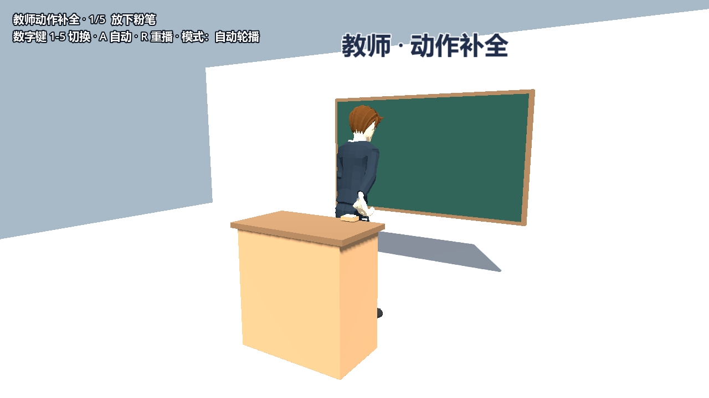

### 18. 把课本放到讲台

`BOOK_PLACE` 2.0 s：双手把课本端在胸前 → 降到 `lectern_node` 台面 → 松手。
课本在放下后留在讲台，不随动作消失。

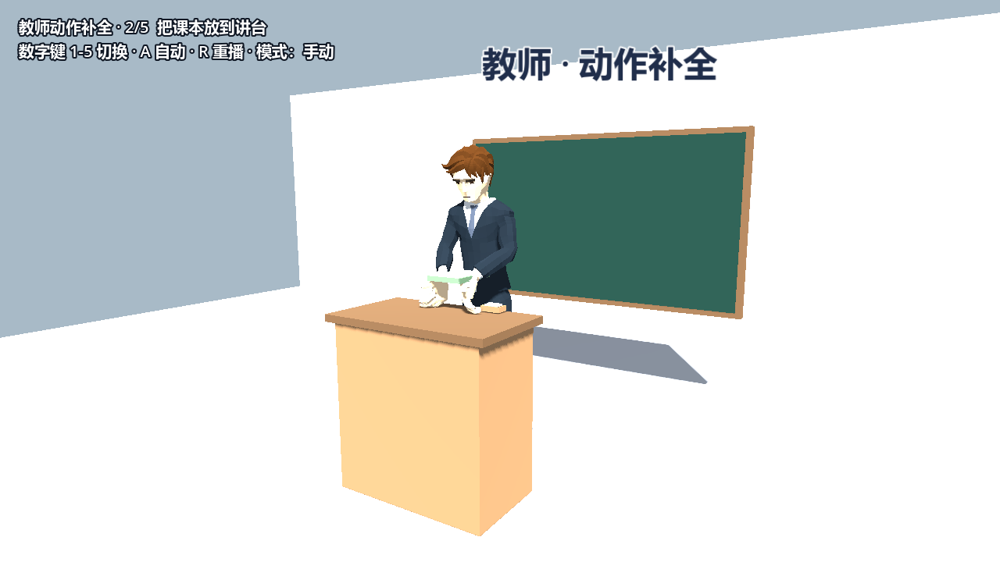

### 19. 指向你

`POINT`：整条手臂朝 `point_target`（Node3D）伸出，只伸直食指，中指/无名指/小指与拇指
收起；头部略抬。演示里目标在观众席左侧，指向动作在画面里完整可见。

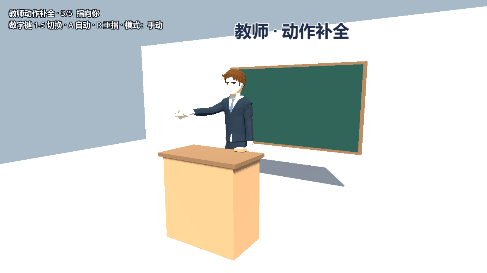

### 20. 讲台 ↔ 黑板走路

`WALK` + `walk_to(target, duration, end_action)`：
- 位移用 smoothstep 缓起缓停，不再均匀滑行；
- 原地循环：大腿 ±24°、小腿抬起 30°、髋部左右 1.5°、双臂反向摆；
- 到点自动切回 `end_action`（默认 `LECTURE`），朝向按行走方向自动计算。

```gdscript
teacher.walk_to(board_front_position, 2.2, TeacherAnimator.Action.LECTURE)
```

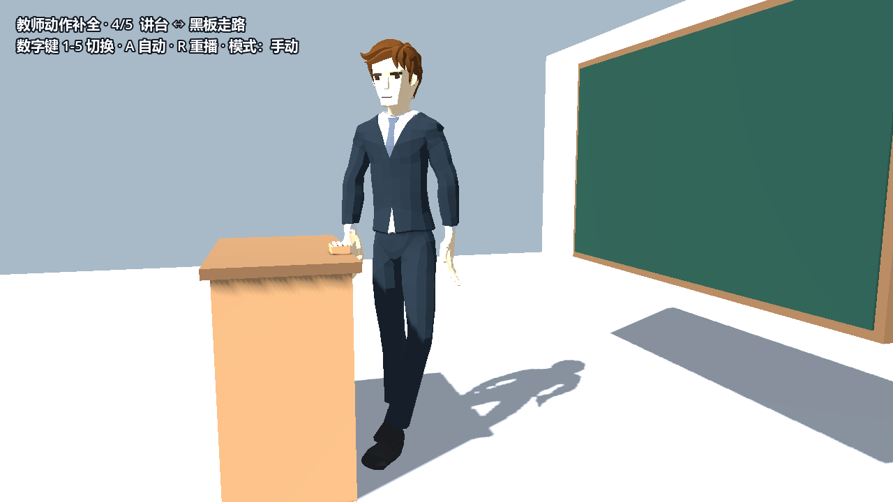

### 21. 讲课中翻课本

`BOOK_FLIP` 2.6 s：左手持书，右手两次捏住页角从左向右扫；书页网格（`PropKit.page()`）
绕书脊旋转 180°，第一页停在左侧，第二次翻页重新开始。粉笔/点名册/课本/粉笔盒
都按实测指骨位置握持，不依赖固定偏移。

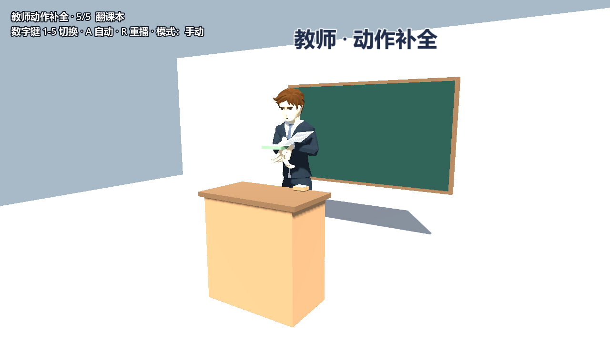

## 六、道具（22~24）

全部为 `scripts/prop_kit.gd` 的静态工厂方法，无外部素材：

| 道具 | 方法 | 结构 |
| --- | --- | --- |
| 笔 | `PropKit.pen(color)` | 笔杆 + 笔帽 + 笔夹 + 笔尖，全长 0.142 m，沿 +X |
| 课本 | `PropKit.textbook(cover_color, size)` | 封面 + 书页 + 书脊，默认 0.21×0.027×0.285 m |
| 粉笔盒 | `PropKit.chalk_box()` | 浅口纸盒 + 3 根粉笔，0.11×0.068 m |
| 铅笔 | `PropKit.pencil()` | 六棱笔杆 + 木尖 + 石墨芯 + 金属箍，0.175 m |
| 橡皮 | `PropKit.eraser()` | 0.046×0.021×0.024 m 方块 |
| 本子 | `PropKit.notebook()` | 封面 + 内页 + 横线，0.19×0.012×0.26 m |
| 书页 | `PropKit.page(width, depth)` | 双面薄片，绕书脊旋转用 |

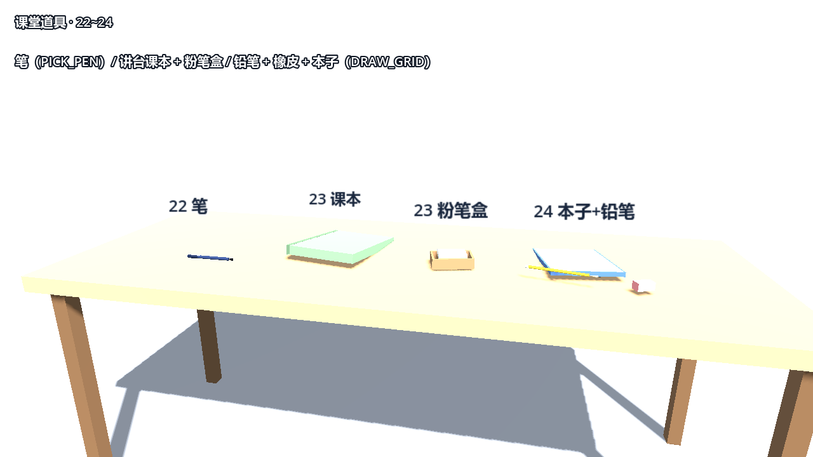

## 七、实现结构

### `scripts/pose_rig.gd`（新增）

把原先分散在 `character_pose.gd` / `teacher_animator.gd` 里验证过的骨骼数学集中成
`PoseRig`（RefCounted，不进场景树）：重置骨骼、欧拉角叠加、坐姿小腿收正（带权重混合）、
自然下垂、两骨解析 IK、手掌坐标系、手指弯曲、髋高读取。师生共用，避免第三份拷贝。

### `scripts/character_action.gd`（新增，主角/同学 16 个动作）

- 17 个 `Clip`，每个有 `label / seated / duration / loop`；
- 每帧从 rest 重建：腿（坐/站权重）→ 髋高落地 → 躯干/颈/头 → 双手 IK → 道具 → 面部；
- 手部目标与角度带平滑（切换动作不会硬切）；
- 一次性动作结束发 `clip_finished`；`seek()` / `warm()` 供无头测试与截图定点；
- 口型/表情复用 `TeacherFace`，`EXPRESSIONS` 预设与 `speaking` 开关；
- 道具（笔/书/本子/铅笔/橡皮）跟随实测指骨，不写死世界坐标。

**关键修正**：先落地（按目标髋高移动 Model）再解手部 IK。之前先解 IK 再整体下沉，
手会跟着身体一起掉到桌面/嘴边下方约 0.45 m，表现为“手够不到本子”。

### `scripts/teacher_animator.gd`（扩展）

在原有 4 动作 × 5 情绪之上追加 5 个 `Action`（`CHALK_DOWN / BOOK_PLACE / POINT / WALK /
BOOK_FLIP`），新增 `lectern_node`、`chalk_box_node`、`point_target` 三个导出锚点、
`walk_to()`、`action_finished` / `walk_finished` 信号、`seek_action()` / `warm_action()`。
原四个动作的分支保持原样，只在 `apply_pose()` 里加了一个“特殊双手”提前返回。

### `scripts/prop_kit.gd`（新增）

课堂道具工厂，见第六节。所有材质粗糙、无高光，与现有程序化道具一致。

### 场景

- `scenes/actors/protagonist/protagonist_actions_preview.tscn`：主角 7 项演示（椅子/课桌/相机/HUD 运行时生成）
- `scenes/actors/classmate/classmate_actions_preview.tscn`：同学 9 项演示
- `scenes/actors/teacher/teacher_extra_preview.tscn`：教师 5 项演示（黑板/讲台/粉笔盒/指向锚点）
- `scenes/actors/props/props_preview.tscn`：22~24 道具陈列
- `scenes/actors/protagonist/protagonist_animated.tscn`、`scenes/actors/classmate/classmate_animated.tscn`：可复用人物模板

演示场景的布景由 `scripts/action_demo_stage.gd` 统一生成，四个场景只写角色和动作。

## 八、接入方式（给流程 / 主开发）

> 本次**没有改** `dialogue_flow.gd`、`classroom_dialogue.tscn` 等流程侧共享文件。
> 以下接口已就绪，接入需要流程负责人确认。

### 主角

```gdscript
var protagonist: CharacterAction = preload("res://scenes/actors/protagonist/protagonist_animated.tscn").instantiate()
protagonist.position = Vector3(-0.7, 0, 1.78)
add_child(protagonist)

protagonist.play_clip(CharacterAction.Clip.SIT_TO_STAND)   # 起身
protagonist.clip_finished.connect(_on_stand_up_finished)
protagonist.play_clip(CharacterAction.Clip.LOOK_AROUND)     # 躲避视线
protagonist.play_clip(CharacterAction.Clip.HAND_ON_DESK)    # 手扶桌边
protagonist.play_clip(CharacterAction.Clip.HAND_RETRACT)    # 手收回
protagonist.speaking = true                                  # 回答时开口
protagonist.expression = "confident"                         # 或 nervous
```

当前流程用的是三个静态场景（`sit.tscn / stand_talk.tscn / look_around.tscn`）硬切；
换成 `CharacterAction` 需要流程侧把 `_set_protagonist_pose()` 改成 `play_clip()`，
并等 `clip_finished` 再推进下一拍（起身 0.8 s、坐下 0.85 s、收回 1.4 s）。

### 同学

```gdscript
classmate.play_clip(CharacterAction.Clip.LAUGH_SHAKE)
classmate.play_clip(CharacterAction.Clip.NOD_FULL)
classmate.play_clip(CharacterAction.Clip.PICK_PEN)
classmate.play_clip(CharacterAction.Clip.WHISPER_LOOP)
classmate.whisper_side = -1          # 向左邻座
classmate.play_clip(CharacterAction.Clip.QUIET_SETTLE)
```

- `PICK_PEN`、`DRAW_GRID`、`LOWER_BOOK` 自带道具，不需要场景里再放；
- 42 个同学同时开面部面片会有额外开销，远景建议 `face_enabled = false`；
- `WHISPER_LOOP` 可配合 `phase_offset` 错开。

### 教师

```gdscript
teacher.lectern_node = $LecternTop          # Marker3D，讲台台面
teacher.chalk_box_node = $ChalkBoxSpot      # Marker3D，粉笔盒位置
teacher.point_target = $ProtagonistSeat     # Marker3D，被点到的人/座位

teacher.set_action(TeacherAnimator.Action.CHALK_DOWN)
teacher.set_action(TeacherAnimator.Action.BOOK_PLACE)
teacher.set_action(TeacherAnimator.Action.POINT)
teacher.set_action(TeacherAnimator.Action.BOOK_FLIP)
teacher.walk_to($BlackboardFront.global_position, 2.2, TeacherAnimator.Action.LECTURE)
```

不设置锚点时：讲台取身体前方 0.45 m、高 0.82 m；指向取正前方 1.2 m。

### 道具

```gdscript
var pen := PropKit.pen()
add_child(pen)
pen.position = drop_point
```

道具是 Node3D，原点在握持/放置中心，+X 为长边、+Y 朝上。

## 九、已知限制与未完成项

1. **弯腰捡笔的地面可达性**：坐姿肩高约 0.9 m，手臂全长约 0.48 m，手到地面需要很深的
   侧弯。当前用 48° 侧倾 + 前倾 10° 表现“弯腰捡起”，手在画面里会落在座位右侧近地面处；
   若中途需要看清笔从桌边滚落，按流程文档建议加一个短暂低头镜头（`camera.look`）。
2. **走路没有脚部 IK/地形适配**：原地循环 + 根节点位移，平地成立；上下讲台或斜坡需要
   另行处理。
3. **翻页只有一页网格**：两次翻页共用同一页片，第二次会从右侧重新开始；远景可接受，
   特写需要拆成两页。
4. **面部是贴面片**：约 1 m 内可读，更远会变成一条线；侧脸/背身时会被头骨遮挡。
5. **道具尺寸按标准文具**：若课堂桌高/桌深与演示不同，`_desk_point()` 的 0.755/0.34
   常量需要按实际桌面调整（集中在 `character_action.gd` 的世界点位函数）。
6. **未改流程**：见第八节，接入需要流程负责人确认；本次只交付人物侧动作与演示。
7. **未做配音**：口型按节奏程序化生成，不对应真实音素；配音到位后仍需按音频时间轴校准。
8. **截图机位**：效果图为演示场景定点截图，`docs/character-actions/` 下按 01~24 编号；
   蹲/坐动作的低角度机位是为了看清手部，不代表游戏内机位。

## 十、验证记录

Godot 4.6.1 标准版、Compatibility、本机：

- [x] `--headless --path . --editor --import --quit`：零 SCRIPT ERROR / 解析错误；
      新脚本 `.uid` 自动生成。
- [x] `tests/character_actions_check.gd`：**PASS（56 checks）**——17 个动作逐一切换并断言
      头/颈/躯干/手臂至少有一处偏离 rest；坐姿髋高 = 0.47、起身终点 = 站立髋高、
      坐下终点 = 0.47；四处看两个落点 yaw 差 > 20°；捡笔时躯干前倾、笔在手里/桌面；
      画方格三件道具可见、擦线窗口橡皮在左手；放低课本落到桌面；掩嘴手到嘴面片距离
      3~16 cm（既不插进头也不悬空）；
      说话时嘴张开 > 0.15；一次性动作发出 `clip_finished`；女性骨架四项动作；
      四个演示场景与两个人物模板可加载并绑定角色；道具工厂件数。
- [x] `tests/teacher_extra_check.gd`：**PASS（25 checks）**——粉笔在放下前可见、末尾消失；
      课本落到讲台高度；指向手与目标方向 dot > 0.80 且手臂伸展 > 0.30 m；走路有位移、
      腿摆动、到点；翻页纸出现并旋转；原四个动作不回归（grip frame 仍生成）。
- [x] `tests/smoke.gd`：PASS（原型主流程未受影响）。
- [x] `tests/teacher_anim_check.gd`：PASS（原教师 4 动作 × 5 情绪与预览场景）。
- [x] `tests/dialogue_check.gd`：PASS（课堂对话流程未受影响）。
- [x] 效果图 24 张（`docs/character-actions/01~24`），已逐张目视检查构图、手部与道具位置。
- [ ] 待人工验收：完整课堂流程接入后的节奏（起身 0.8 s / 坐下 0.85 s 是否够）、
      42 人同时交头接耳的性能、配音到位后的口型对齐。

## 十一、文件清单

新增：

- `scripts/pose_rig.gd`
- `scripts/character_action.gd`
- `scripts/prop_kit.gd`
- `scripts/action_demo_stage.gd`
- `scripts/protagonist_actions_demo.gd`
- `scripts/classmate_actions_demo.gd`
- `scripts/teacher_extra_demo.gd`
- `scripts/props_demo.gd`
- `scenes/actors/protagonist/protagonist_actions_preview.tscn`
- `scenes/actors/protagonist/protagonist_animated.tscn`
- `scenes/actors/classmate/classmate_actions_preview.tscn`
- `scenes/actors/classmate/classmate_animated.tscn`
- `scenes/actors/teacher/teacher_extra_preview.tscn`
- `scenes/actors/props/props_preview.tscn`
- `tests/character_actions_check.gd`
- `tests/teacher_extra_check.gd`
- `docs/character-actions/01~24-*.png`
- 本文件

修改：

- `scripts/teacher_animator.gd`（追加 5 动作、锚点、走路、翻页、讲台道具）
- `docs/素材登记.md`（CHAR-003）

未改（按约定留给流程负责人）：

- `scripts/dialogue_flow.gd`、`scenes/classroom_dialogue.tscn`、
  `scripts/character_pose.gd`、`scripts/teacher_face.gd`、`scripts/dialogue_camera.gd`、
  `content/classroom_dialogue.json`、`scenes/main.tscn`、`project.godot`
